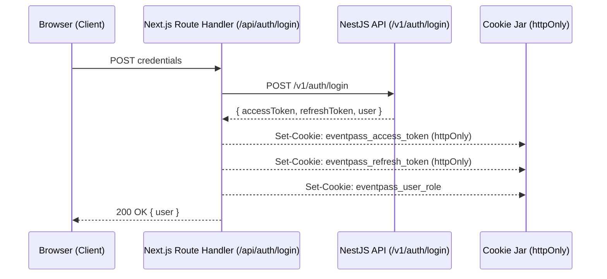

# EventPass Web Application 🎟️

A production-grade modern web frontend for **EventPass**, an event ticketing and RSVP platform engineered for high-concurrency environments.

Built with **Next.js 15 (App Router)**, **React 19**, **TypeScript (Strict Mode)**, **Tailwind CSS**, and **openapi-fetch**. Consumes the EventPass NestJS REST API with 100% end-to-end type safety generated directly from the OpenAPI specification.

---

## 🌟 Key Architecture & Technical Highlights

- **Server-First Rendering**: Public discovery catalogs (`/events`) and dynamic event pages (`/events/[slug]`) are server-rendered on demand with optimized streaming skeleton states.
- **100% Type-Safe API Client**: Built on `openapi-typescript` and `openapi-fetch`. Every endpoint, request body, query parameter, and HTTP response shape is statically inferred from the backend OpenAPI JSON without manual type duplication.
- **Secure `httpOnly` Cookie Sessions**: Access and refresh tokens are stored strictly in `httpOnly`, `SameSite=Lax`, secure cookies. JavaScript in the browser never touches or inspects raw JWT tokens, mitigating XSS risks.
- **Transparent Token Rotation**: Server components and route handlers automatically detect expired access tokens and seamlessly rotate tokens via `POST /v1/auth/refresh` without user friction.
- **Zero-Overbooking Guaranteed UX**: High-concurrency RSVPs are backed by PostgreSQL row locks (`SELECT ... FOR UPDATE`), with instant UI feedback on 409 capacity conflicts.
- **Cryptographic QR Wallet**: Dynamic ticket rendering using `qrcode.react` (`QRCodeSVG`) displaying 160-bit cryptographically random codes with browser print/PDF export.
- **Organizer Command Hub**: Metrics overview, live card preview while typing event details, one-click publish toggle, and attendee roster with RFC 4180-compliant CSV download.

---

## 🏗️ System & Route Directory

```
frontend/
├── src/
│   ├── app/
│   │   ├── (auth)/
│   │   │   ├── login/page.tsx               # Sign in with quick-fill demo accounts
│   │   │   └── register/page.tsx            # Attendee & Organizer registration
│   │   ├── api/auth/                        # Next.js Route Handlers (cookie proxies)
│   │   │   ├── login/route.ts
│   │   │   ├── logout/route.ts
│   │   │   ├── me/route.ts
│   │   │   ├── refresh/route.ts
│   │   │   └── register/route.ts
│   │   ├── dashboard/                       # Organizer Hub (protected)
│   │   │   ├── page.tsx                     # Metrics overview & hosted events list
│   │   │   ├── events/new/page.tsx          # Create event form with live card preview
│   │   │   ├── events/[id]/edit/page.tsx    # Edit event form
│   │   │   └── events/[id]/attendees/page.tsx # Attendee roster & CSV export
│   │   ├── events/
│   │   │   ├── page.tsx                     # Public events catalog (search & filters)
│   │   │   ├── [slug]/page.tsx              # Dynamic detail with Open Graph SEO & RSVP
│   │   │   ├── [slug]/not-found.tsx         # Event 404 handler
│   │   │   └── loading.tsx                  # Streaming skeleton loader
│   │   ├── my-tickets/
│   │   │   ├── page.tsx                     # Attendee ticket wallet & QR passes
│   │   │   └── loading.tsx
│   │   ├── error.tsx                        # Root client error boundary with reset
│   │   ├── global-error.tsx                 # Catch-all fatal HTML error boundary
│   │   ├── not-found.tsx                    # Branded global 404 page
│   │   ├── layout.tsx                       # Root layout with Navbar & Footer
│   │   └── page.tsx                         # Landing page with featured upcoming events
│   ├── components/
│   │   ├── dashboard/                       # EventForm, EventRowActions, AttendeeRoster
│   │   ├── events/                          # EventCard, EventFilters, EventRsvpButton
│   │   ├── layout/                          # Navbar, Footer
│   │   ├── tickets/                         # TicketCard (QR stub), TicketTabs
│   │   └── ui/                              # Badge, Button, Card, Input, Pagination, Skeleton
│   ├── lib/
│   │   ├── actions/                         # Server actions (rsvp, events)
│   │   ├── api/                             # schema.d.ts, client.ts, server-client.ts
│   │   ├── auth/                            # cookies.ts, session.ts
│   │   ├── utils/                           # date.ts, utils.ts
│   │   └── validations/                     # Zod schemas (auth.schema.ts, event.schema.ts)
│   └── middleware.ts                        # Edge route guard for /dashboard & /my-tickets
```

---

## 🔒 Authentication Flow



---

## 🚀 Getting Started

### 1. Prerequisites
- Node.js 20+ (LTS)
- Running EventPass NestJS backend on `http://localhost:3000`

### 2. Environment Setup
Create a `.env.local` file in `frontend/`:
```bash
cp .env.example .env.local
```

Default configuration:
```env
NEXT_PUBLIC_API_URL=http://localhost:3000
INTERNAL_API_URL=http://localhost:3000
NEXT_PUBLIC_APP_URL=http://localhost:3001
```

### 3. Install Dependencies
```bash
npm install
```

### 4. Sync API Types (OpenAPI Code Generation)
Whenever the NestJS API specification updates:
```bash
# 1. In backend/ directory:
npm run export:openapi

# 2. In frontend/ directory:
npm run codegen:api
```
This generates `frontend/src/lib/api/schema.d.ts` directly from `backend/openapi.json`.

### 5. Run Development Server
```bash
npm run dev
```
Open [http://localhost:3000](http://localhost:3000) (or Next.js port) in your browser.

---

## 🧪 Production Build & Linting

```bash
# Run ESLint validation
npm run lint

# Compile optimized production build
npm run build

# Start production server
npm run start
```

---

## 💡 Pre-Seeded Test Accounts

When testing against the local database seeded with `npm run prisma:seed` in `backend/`:

| Role | Email | Password | Primary Capabilities |
| :--- | :--- | :--- | :--- |
| **Organizer** | `organizer@eventpass.io` | `Password123!` | Create/edit events, toggle publish, inspect attendee rosters, export CSV |
| **Attendee 1** | `user1@eventpass.io` | `Password123!` | Browse events, RSVP, claim QR tickets, cancel passes |
| **Attendee 2** | `user2@eventpass.io` | `Password123!` | Multi-attendee RSVP and wallet testing |
| **Admin** | `admin@eventpass.io` | `Password123!` | Full system and organizer access |
